<p align="center">
  
</p>

<p align="center">
  <a href="../pyproject.toml"></a>
  <a href="../LICENSE"></a>
  <a href="https://github.com/xShadyy/H5Reclaim/blob/main/benchmarks/results/v100rc1-release-coverage.json"></a>
</p>

<p align="center">
  <strong>Sprachen:</strong>
  <a href="../README.md" lang="en">English</a> · <a href="README.pl.md" lang="pl">Polski</a> · <a href="README.de.md" lang="de">Deutsch</a> · <a href="README.fr.md" lang="fr">Français</a> · <a href="README.es.md" lang="es">Español</a> · <a href="README.pt-BR.md" lang="pt-BR">Português (Brasil)</a><br>
  <a href="README.zh-CN.md" lang="zh-CN">简体中文</a> · <a href="README.ja.md" lang="ja">日本語</a> · <a href="README.ko.md" lang="ko">한국어</a> · <a href="README.ru.md" lang="ru">Русский</a> · <a href="README.ar.md" lang="ar">العربية</a>
</p>

H5Reclaim stellt wissenschaftliche Daten aus beschädigten HDF5-Dateien wieder her. Nach abgebrochenen Schreibvorgängen, defekten Indizes, beschädigten Metadaten oder abgeschnittenen Dateien überträgt es erhaltene Messwerte in eine neue, nutzbare Datei. HDF5 ist das Format, in dem viele wissenschaftliche Geräte und Anwendungen Arrays, Messwerte und die zugehörigen Metadaten speichern.

**Ein einziger Befehl findet die Datensätze, wählt Wiederherstellungsverfahren und erstellt eine neue HDF5-Datei mit einem übersichtlichen JSON-Bericht.** Das Original bleibt unverändert. H5Reclaim übernimmt lesbare Messwerte aus teilweise beschädigten Datensätzen und setzt die Wiederherstellung für den Rest der Datei fort.

Der Release Candidate 1.0.0rc1 erzielte **95.4% nützliche Wiederherstellungen in 109 kontrollierten Versuchen mit beschädigten Dateien**: 77 vollständig exakte und 27 teilweise Wiederherstellungen, ohne einen einzigen fälschlich akzeptierten Wert in dieser Versuchsreihe. Diese generierten Versuche messen die angegebenen Fehlerklassen und lassen keine erwartete Erfolgsquote für andere Dateien erkennen. [Ergebnisse ansehen](https://github.com/xShadyy/H5Reclaim/blob/main/benchmarks/results/v100rc1-release-coverage.json).

<a id="quick-start"></a>
## Schnellstart

Du benötigst Python 3.10 oder neuer. Klone dieses Repository oder lade die ZIP-Datei von GitHub herunter und entpacke sie:

```sh
git clone https://github.com/xShadyy/H5Reclaim.git
cd H5Reclaim
```

Installiere das Tool im Stammverzeichnis des Repositorys und stelle eine Datei wieder her:

```sh
python -m pip install .
python -m h5reclaim rescue "damaged.h5"
```

## Ergebnis verstehen

Die Zusammenfassung im Terminal zeigt, ob die Wiederherstellung vollständig oder teilweise gelang, und nennt die Ausgabepfade. Der JSON-Bericht führt wiederhergestellte Datensätze, Wiederherstellungsverfahren, ungeklärte Positionen und wiederhergestellte Metadaten auf.

Wenn ein Wiederherstellungsverfahren eine **Statuskarte** ausgibt, zeigt diese, an welchen Positionen akzeptierte Messwerte liegen. Wähle die Werte für die Analyse anhand der im Bericht genannten Karte aus; unbekannte Positionen können einen Füllwert wie null anzeigen. Für manche intakten zusammenhängenden Datensätze und Null-Datensätze gibt es keine überprüfbare Karte. Ziehe deshalb vor der Analyse den Bericht zum jeweiligen Verfahren heran. Frühere Referenzstände und Schutzpakete ermöglichen den Vergleich mit einer älteren Aufnahme.

## Lizenz

Der Quellcode steht unter der [Apache-Lizenz 2.0](../LICENSE). Für die mitgelieferten wissenschaftlichen Dateien gelten [gesonderte Quellenangaben und Lizenzen](https://github.com/xShadyy/H5Reclaim/blob/main/corpus/README.md).

<sub>Erstellt von Tymoteusz Netter.</sub>
